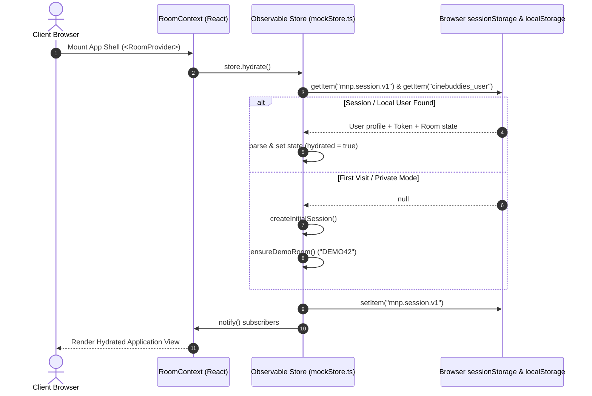
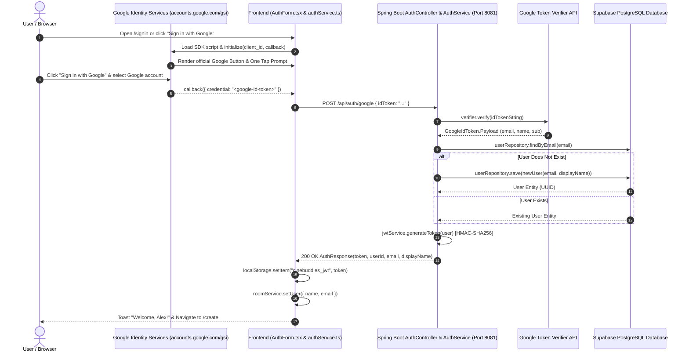
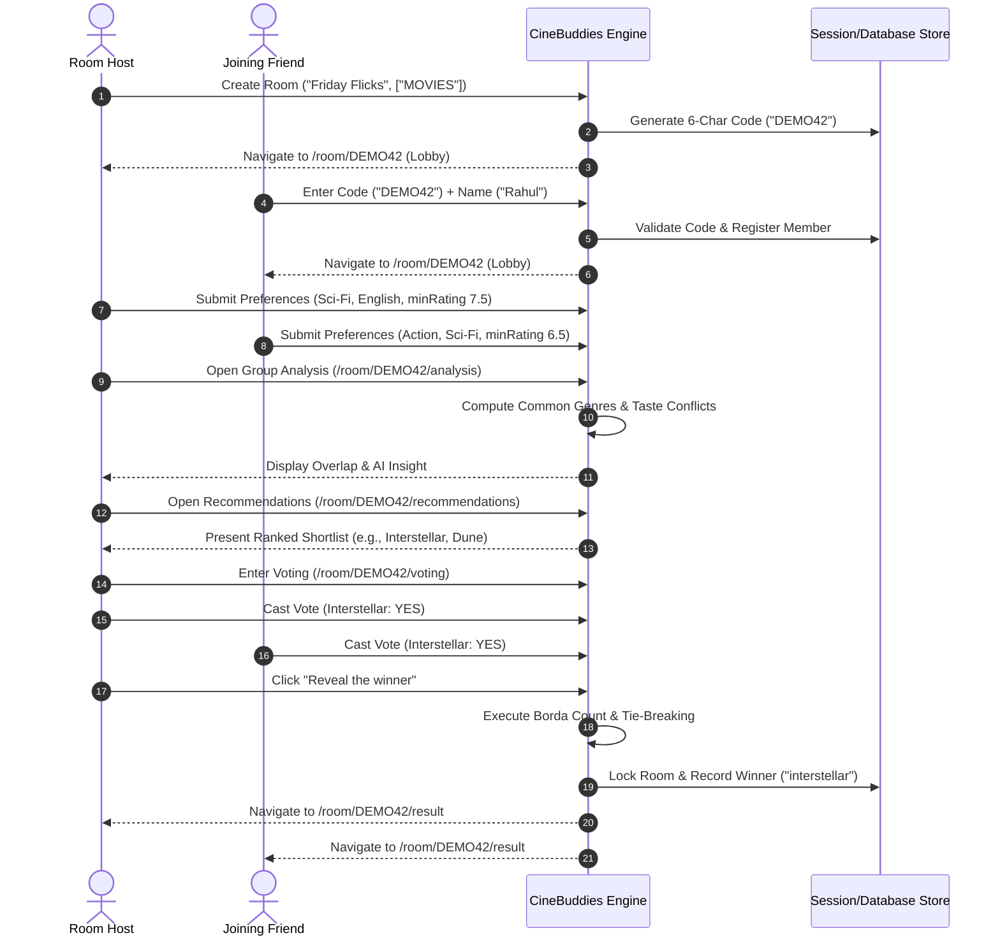
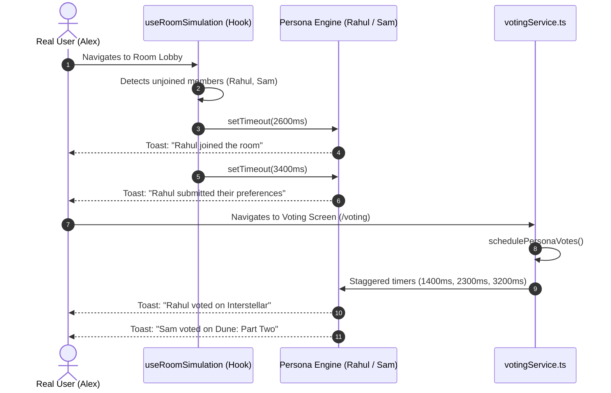

# CineBuddies — Technical Manual & Architecture Reference
**Document Title:** `PROJECT_FULL_DOCUMENTATION.md`  
**System Name:** CineBuddies (Midnight Movie Match / Movie Night Planner)  
**Document Version:** 1.1.0  
**Classification:** Core System Architecture & Production Engineering Manual  
**Target Audience:** Principal Architects, Full-Stack Engineers, DevOps Engineers, Security Auditors  

---

## Table of Contents

1. [Project Summary & Prerequisites](#1-project-summary--prerequisites)
   - 1.1 [Executive Summary](#11-executive-summary)
   - 1.2 [System Prerequisites & Toolchain](#12-system-prerequisites--toolchain)
2. [Project Overview, Goals & Problem Statement](#2-project-overview-goals--problem-statement)
   - 2.1 [Problem Statement](#21-problem-statement)
   - 2.2 [Core Goals & Value Proposition](#22-core-goals--value-proposition)
3. [Architecture, System Design & Folder Structure](#3-architecture-system-design--folder-structure)
   - 3.1 [High-Level Architecture Overview](#31-high-level-architecture-overview)
   - 3.2 [Design System & Theming Architecture](#32-design-system--theming-architecture)
   - 3.3 [Clean Folder Structure](#33-clean-folder-structure)
   - 3.4 [Infrastructure & Hosting Model](#34-infrastructure--hosting-model)
4. [File-by-File Breakdown & Source Code Reference](#4-file-by-file-breakdown--source-code-reference)
   - 4.1 [Frontend Framework & Scaffolding](#41-frontend-framework--scaffolding)
   - 4.2 [Frontend State Management & Storage Layer](#42-frontend-state-management--storage-layer)
   - 4.3 [Frontend Services & API Access Layer](#43-frontend-services--api-access-layer)
   - 4.4 [Frontend Domain Components & UI Views](#44-frontend-domain-components--ui-views)
   - 4.5 [Backend Architecture, Controllers & Security](#45-backend-architecture-controllers--security)
   - 4.6 [Backend Repositories, DTOs & Domain Models](#46-backend-repositories-dtos--domain-models)
5. [Module, Function & Business Logic Guide](#5-module-function--business-logic-guide)
   - 5.1 [Fair Group Voting Algorithm](#51-fair-group-voting-algorithm)
   - 5.2 [Group Analysis & Taste Divergence Engine](#52-group-analysis--taste-divergence-engine)
   - 5.3 [Room Code Generation & Normalization](#53-room-code-generation--normalization)
   - 5.4 [Simulated Multiplayer State Machine](#54-simulated-multiplayer-state-machine)
6. [Database Schema, Models & State Management](#6-database-schema-models--state-management)
   - 6.1 [In-Memory & Client State Model](#61-in-memory--client-state-model)
   - 6.2 [PostgreSQL Database Schema & Flyway Migration DDL](#62-postgresql-database-schema--flyway-migration-ddl)
   - 6.3 [Security Rules & Data Access Policies](#63-security-rules--data-access-policies)
   - 6.4 [Query Indexes & Performance Plan](#64-query-indexes--performance-plan)
7. [API Reference & Contract](#7-api-reference--contract)
   - 7.1 [Client-Side Navigation & Route Contract](#71-client-side-navigation--route-contract)
   - 7.2 [Backend REST API Endpoints Matrix](#72-backend-rest-api-endpoints-matrix)
8. [Runtime Flow Diagrams](#8-runtime-flow-diagrams)
   - 8.1 [Authentication & Session Bootstrapping](#81-authentication--session-bootstrapping)
   - 8.2 [End-to-End Google Identity Services & JWT Auth Flow](#82-end-to-end-google-identity-services--jwt-auth-flow)
   - 8.3 [Core Business Transaction Flow](#83-core-business-transaction-flow)
   - 8.4 [Simulated Participant & Voting Pipeline](#84-simulated-participant--voting-pipeline)
9. [Configuration & Environment Variables](#9-configuration--environment-variables)
10. [Annotated Core Implementation Details](#10-annotated-core-implementation-details)
    - 10.1 [Observable Store with External Sync](#101-observable-store-with-external-sync)
    - 10.2 [SSR-Safe Hydration & Error Capture Pipeline](#102-ssr-safe-hydration--error-capture-pipeline)
    - 10.3 [Group Conflict & Overlap Calculus](#103-group-conflict--overlap-calculus)
11. [Dependency Graph (Internal & External)](#11-dependency-graph-internal--external)
    - 11.1 [External Dependencies Analysis](#111-external-dependencies-analysis)
    - 11.2 [Internal Module Dependency Topology](#112-internal-module-dependency-topology)
12. [Testing Strategy](#12-testing-strategy)
    - 12.1 [Test Suite Inventory & Framework Architecture](#121-test-suite-inventory--framework-architecture)
    - 12.2 [Execution Runbook](#122-execution-runbook)
13. [CI/CD Pipeline Configuration](#13-cicd-pipeline-configuration)
14. [Deployment & DevOps Guide](#14-deployment--devops-guide)
    - 14.1 [Containerization (Docker & Compose)](#141-containerization-docker--compose)
    - 14.2 [Static Hosting & Reverse Proxy (Nginx)](#142-static-hosting--reverse-proxy-nginx)
15. [Rollback, Backup, Disaster Recovery & Scaling](#15-rollback-backup-disaster-recovery--scaling)
16. [Security & Best Practices Checklist](#16-security--best-practices-checklist)
17. [Performance Optimization Guide](#17-performance-optimization-guide)
18. [Troubleshooting Guide (10+ Scenarios)](#18-troubleshooting-guide-10-scenarios)
19. [Changelog & Version History](#19-changelog--version-history)
20. [Future Scope & Improvement Roadmap](#20-future-scope--improvement-roadmap)
21. [How to Get Help, Debugging & Maintainer Support](#21-how-to-get-help-debugging--maintainer-support)

---

## 1. Project Summary & Prerequisites

### 1.1 Executive Summary
**CineBuddies** (historically codenamed *Midnight Movie Match* or *Movie Night Planner*) is a full-stack collaborative social platform engineered to eliminate group decision paralysis during movie nights. Rather than spending 45 minutes scrolling through fragmented streaming catalogs, groups of friends join a synchronized room via a 6-character room code, submit individual content constraints (content types, genres, languages, release eras, minimum ratings, and hard exclusions), receive instant AI-driven aggregate group taste analysis, and participate in a weighted voting round (`Yes` = +2, `Maybe` = +1, `No` = 0) to deterministically converge on a single winner.

The project is structured as a production-grade monorepo containing:
- **`Frontend/`**: A modern server-side rendered (SSR) web client constructed with **React 19**, **TanStack Start**, **TanStack Router**, **Vite 8**, **Tailwind CSS v4**, and **Radix UI**. The client features a unified **Google Identity Services (GSI)** authentication experience (one-click "Sign in with Google" and Google One Tap), and connects via REST to the Spring Boot backend or falls back to an observable mock store with simulated multiplayer participants (`Alex`, `Rahul`, `Sam`).
- **`Backend/`**: A fully functional, production-ready REST service tier built with **Java 21**, **Spring Boot 4.0.9**, **Spring Security 6**, **Spring Data JPA**, **Flyway**, **Google API Client (`GoogleIdTokenVerifier`)**, and **JJWT 0.12.5**. It runs on port `8081` and connects directly to a live **PostgreSQL** database hosted on **Supabase**.

### 1.2 System Prerequisites & Toolchain

| Tool / Runtime | Required Version | Supported Range | Purpose in Architecture | Verification Command |
| :--- | :--- | :--- | :--- | :--- |
| **Node.js** | `v22.20.0` (LTS) | `^20.18.0` or `>=22.0.0` | Frontend runtime, SSR runner, build toolchain | `node -v` |
| **npm** | `v10.9.9` | `>=10.8.0` | Frontend package manager | `npm -v` |
| **TypeScript** | `5.8.3` | `^5.8.0` | Static typing, interface integrity, JSX transforms | `npx tsc -v` |
| **Vite** | `8.1.5` | `^8.0.0` | Dev server, HMR, client/server bundler (port 5173) | `npx vite -v` |
| **Java JDK** | `21` | `>=21.0.0` | Backend Spring Boot service execution | `java -version` |
| **Maven** | `3.9+` | `>=3.8.0` | Java backend build system and dependency management | `mvn -v` |
| **PostgreSQL** | `15+` / Supabase | `>=15.0` | Primary relational data store for rooms, users, and votes | `psql --version` |
| **System Memory** | 8 GB RAM min. | 16 GB RAM rec. | Local dev execution (Vite SSR + Nitro + Spring Boot + DB) | Task Manager / `free -m` |
| **Disk Space** | 2 GB free | 5 GB free | Node modules, build artifacts, container layers | `df -h` |

---

## 2. Project Overview, Goals & Problem Statement

### 2.1 Problem Statement
When groups gather in person or virtually to watch movies or episodic series, they routinely suffer from:
1. **Asymmetric Preferences**: One viewer cannot stand horror, another refuses subtitles, while a third only watches post-2020 releases. Surfacing these hidden constraints verbally leads to friction.
2. **Analysis Paralysis**: Traversing Netflix, Prime Video, or Disney+ catalogs manually leads to endless trailer browsing and decision fatigue.
3. **Unfair Compromises**: Dominant personalities dictate the movie choice, leaving other participants disengaged.
4. **Disconnected Tools**: Existing tools either provide raw movie reviews (IMDb, Letterboxd) without room-based coordination or offer simplistic binary swiping without multi-preference constraint satisfaction.

### 2.2 Core Goals & Value Proposition
- **Room-Centric Multiplayer Coordination**: Zero-install, instant entry via randomized 6-character invitation codes (`DEMO42`, `ABCDEF`) with instant URL sharing.
- **Multivariate Constraint Aggregation**: Collects preferred and excluded genres, multiple spoken audio languages, minimum rating thresholds (0.0 to 10.0), and release periods (`ANY_YEAR`, `LAST_5_YEARS`, `LAST_10_YEARS`, `CLASSIC`).
- **Explainable Group AI Analysis**: Identifies exact common genre intersections, highlights critical conflicts (e.g., Alex loves Thriller while Sam excludes Thriller), and calculates average acceptable ratings.
- **Weighted Democratic Convergence**: A 3-tier ballot (`Yes` = +2, `Maybe` = +1, `No` = 0) with automatic tie-breaking based on overall group match percentage ensures mathematically optimal consensus.
- **Zero-Friction Prototype with Instant Production Swappability**: Ships with an in-memory session-persisted store and simulated participants so the application is completely functional without a live database, yet designed so changing `USE_MOCK_SERVICES = false` seamlessly switches to production Spring Boot REST endpoints.

---

## 3. Architecture, System Design & Folder Structure

### 3.1 High-Level Architecture Overview

```
                      +-------------------------------------------------------------+
                      |                      CLIENT BROWSER                         |
                      |                                                             |
                      |   [TanStack Start SSR Engine / Nitro Server Handler]        |
                      |                                                             |
                      |   +-----------------------------------------------------+   |
                      |   | React 19 UI View Layer (Tailwind v4 / Radix UI)     |   |
                      |   | 11 Screens: Landing, Auth, Room, Lobby, Preferences, |   |
                      |   |             Analysis, Picks, Voting, Result         |   |
                      |   +--------------------------+--------------------------+   |
                      |                              |                              |
                      |                              v                              |
                      |   +-----------------------------------------------------+   |
                      |   | React Session Context (RoomContext.tsx)             |   |
                      |   | - useSyncExternalStore Listener                     |   |
                      |   | - Simulated Multiplayer Bot Dispatcher              |   |
                      |   +--------------------------+--------------------------+   |
                      +------------------------------|------------------------------+
                                                     |
                                                     v
                       +-----------------------------------------------------------+
                       |              DATA ACCESS ABSTRACTION LAYER                |
                       |                                                           |
                       |  USE_MOCK_SERVICES = true        USE_MOCK_SERVICES = false|
                       |             |                                   |         |
                       v             v                                   v         v
+---------------------------------------------+   +---------------------------------------------+
|        CLIENT MOCK & SESSION STORE          |   |     FUTURE JAVA SPRING BOOT REST BACKEND     |
|                                             |   |                                             |
|  - Observable Store (mockStore.ts)          |   |  - RoomController (/api/rooms)              |
|  - In-Memory State Trees                    |   |  - PreferenceController (/preferences)      |
|  - Browser SessionStorage Mirroring         |   |  - RecommendationController (/analysis)     |
|  - Seed Personas (Alex, Rahul, Sam)         |   |  - VotingController (/votes, /finalize)     |
|  - Simulated Delayed Action Queues          |   |  - Spring Data JPA Repositories             |
+---------------------------------------------+   +----------------------+----------------------+
                                                                         |
                                                                         v
                                                  +---------------------------------------------+
                                                  |             POSTGRESQL DATABASE             |
                                                  |  - rooms, members, preferences,             |
                                                  |    movies, votes, room_results              |
                                                  +---------------------------------------------+
```

### 3.2 Design System & Theming Architecture
The user interface follows a cinematic dark room aesthetic defined in [Frontend/src/styles.css](file:///d:/New%20folder%20(4)/Cine-Buddies/Frontend/src/styles.css) utilizing **Tailwind CSS v4** with the `@theme inline` directive and custom OKLCH color spaces:

- **Background Canvas**: `oklch(0.179 0.010 276.4)` (`#101116`) — Ultra-deep cinema neutral.
- **Card Surfaces**: `oklch(0.224 0.018 275.1)` (`#191B24`) — Secondary container background.
- **Elevated Modals & Popovers**: `oklch(0.287 0.022 273.9)` (`#272A36`) — High-contrast surface.
- **Brand Primary Accent**: `oklch(0.628 0.174 290.9)` (`#8B70E8`) — Vibrant cinema purple.
- **Lavender Highlight**: `oklch(0.777 0.125 292.7)` (`#B9A7FF`) — Soft accent for active states.
- **Success State**: `oklch(0.703 0.133 164.6)` (`#35B98A`) — Positive votes and high compatibility.
- **Warning State**: `oklch(0.765 0.130 72.1)` (`#E5A44B`) — Medium compatibility and Maybe votes.
- **Destructive State**: `oklch(0.620 0.190 25.0)` — Negative No votes and room exit warnings.
- **Aspect Ratio Standard**: All media components implement a fixed `2:3` vertical aspect ratio matching theatrical posters.

### 3.3 Clean Folder Structure

```text
CineBuddies/
│
├── .gitignore                            # Root monorepo Git exclusion definitions
├── PROJECT_FULL_DOCUMENTATION.md         # Production technical manual and architecture reference
├── README.md                             # Monorepo root index and rapid onboarding guide
│
├── Backend/                              # Production Java 21 / Spring Boot 4 / PostgreSQL backend (Port 8081)
│   ├── .env                              # Environment variables (DB_URL, DB_USERNAME, DB_PASSWORD, GOOGLE_CLIENT_ID, JWT_SECRET)
│   ├── pom.xml                           # Maven descriptor (Spring Boot 4.0.9, PostgreSQL, Flyway, JJWT 0.12.5, Google API Client)
│   └── src/
│       ├── main/
│       │   ├── java/com/cinebuddies/
│       │   │   ├── CinebuddiesBackendApplication.java # Spring Boot entry point with dotenv loader
│       │   │   ├── config/
│       │   │   │   ├── JwtAuthenticationFilter.java    # JWT Bearer token security interceptor
│       │   │   │   └── SecurityConfig.java            # Stateless Spring Security 6 & CORS configuration
│       │   │   ├── controller/
│       │   │   │   ├── AuthController.java            # POST /api/auth/google endpoint
│       │   │   │   └── RoomController.java            # POST /api/rooms, POST /api/rooms/{code}/join, GET /api/rooms/{code}
│       │   │   ├── dto/
│       │   │   │   ├── auth/
│       │   │   │   │   ├── AuthResponse.java          # Java 21 record (token, userId, email, displayName)
│       │   │   │   │   └── GoogleLoginRequest.java    # Java 21 record (idToken)
│       │   │   │   ├── CreateRoomRequest.java         # Java 21 record (name, contentTypes, hostName)
│       │   │   │   ├── JoinRoomRequest.java           # Java 21 record (displayName)
│       │   │   │   ├── RoomMemberResponse.java        # Java 21 record (id, name, isHost, joined, preferencesSubmitted)
│       │   │   │   └── RoomResponse.java              # Java 21 record (code, name, contentTypes, createdAt, members)
│       │   │   ├── exception/
│       │   │   │   └── GlobalExceptionHandler.java    # Controller advice producing structured JSON error responses
│       │   │   ├── model/
│       │   │   │   ├── ContentType.java               # Enum (MOVIES, TV_SERIES, WEB_SERIES)
│       │   │   │   ├── Room.java                      # JPA Entity for rooms table
│       │   │   │   ├── RoomMember.java                # JPA Entity for room_members table
│       │   │   │   └── User.java                      # JPA Entity for users table
│       │   │   ├── repository/
│       │   │   │   ├── RoomMemberRepository.java      # Spring Data JPA repository for room_members
│       │   │   │   ├── RoomRepository.java            # Spring Data JPA repository for rooms
│       │   │   │   └── UserRepository.java            # Spring Data JPA repository for users
│       │   │   └── service/
│       │   │       ├── AuthService.java               # GoogleIdTokenVerifier & Supabase User upsert
│       │   │       ├── JwtService.java                # HMAC-SHA JJWT generator & token validator
│       │   │       └── RoomService.java               # Room creation, joining, and member queries
│       │   └── resources/
│       │       ├── application.properties         # Server port 8081, Supabase DB, Flyway, JWT, Google keys
│       │       └── db/migration/
│       │           └── V1__Initial_Schema.sql     # Flyway PostgreSQL initial DDL migration
│
└── Frontend/                             # TanStack Start SSR React 19 web application (Port 5173)
    ├── .env                              # VITE_API_BASE_URL (http://localhost:8081/api), VITE_GOOGLE_CLIENT_ID
    ├── .gitignore                        # Frontend build and artifact ignore patterns
    ├── .npmrc                            # npm configuration (legacy-peer-deps=true)
    ├── components.json                   # Shadcn UI CLI path and styling configuration
    ├── eslint.config.js                  # ESLint flat configuration (Prettier, React Hooks, TS)
    ├── package.json                      # Node manifest (dependencies, scripts, overrides)
    ├── README.md                         # Project specification & frontend requirements
    ├── tsconfig.json                     # TypeScript strict configuration with @/* path mappings
    ├── vite.config.ts                    # Lovable TanStack Start Vite bundler configuration
    ├── vitest.config.ts                  # Vitest test suite configuration with JSDOM
    │
    ├── public/                           # Static assets served from server root
    │   ├── favicon.ico                   # Browser tab icon
    │   └── robots.txt                    # Search engine crawler directives
    │
    └── src/                              # Application source code
        ├── routeTree.gen.ts              # TanStack Router auto-generated route manifest
        ├── router.tsx                    # QueryClient instantiation and createRouter entry
        ├── server.ts                     # Nitro SSR server entry and catastrophic error boundary
        ├── start.ts                      # TanStack Start CSRF & global error middleware
        ├── styles.css                    # Tailwind CSS v4 design tokens and base styles
        │
        ├── components/                   # Reusable UI component hierarchy
        │   ├── common/                   # Atomic presentation primitives
        │   │   ├── Button.tsx            # Button with CVA variants (primary, secondary, ghost)
        │   │   ├── EmptyState.tsx        # Zero-state illustration and recovery action
        │   │   ├── Input.tsx             # Text, email, and password input with error label
        │   │   ├── LoadingState.tsx      # Centered animated loading spinner
        │   │   ├── MatchScore.tsx        # Circular SVG score indicator with dynamic color
        │   │   ├── Modal.tsx             # Radix Dialog wrapper with cinematic overlay
        │   │   ├── PosterPlaceholder.tsx # 2:3 aspect ratio placeholder with Lucide icons
        │   │   └── Toast.tsx             # Sonner toast container abstraction
        │   │
        │   ├── movie-night/              # Domain-specific composite components
        │   │   ├── AppHeader.tsx         # Global navigation bar with Google Sign-in button & user sign-out
        │   │   ├── AuthForm.tsx          # Unified Google Identity Services (GSI) 1-click button & One Tap
        │   │   ├── ChipGroup.tsx         # Selectable multi-tag chip group (genres, languages)
        │   │   ├── MemberCard.tsx        # Participant status card with ready indicator
        │   │   ├── MovieCard.tsx         # Movie item card with MatchScore and details trigger
        │   │   ├── MovieDetailsModal.tsx # Detailed why-recommended breakdown dialog
        │   │   ├── PreferenceForm.tsx    # 7-field preference collection interactive form
        │   │   ├── RoomCodeCard.tsx      # Copyable 6-character room code invitation box
        │   │   ├── Stepper.tsx           # Multi-step room stage progression bar
        │   │   └── VoteControls.tsx      # Yes (+2), Maybe (+1), No (0) voting button group
        │   │
        │   └── ui/                       # Comprehensive Radix UI and Shadcn component suite
        │       ├── accordion.tsx, alert-dialog.tsx, aspect-ratio.tsx, avatar.tsx,
        │       ├── badge.tsx, button.tsx, calendar.tsx, card.tsx, carousel.tsx,
        │       ├── chart.tsx, checkbox.tsx, collapsible.tsx, command.tsx,
        │       ├── context-menu.tsx, dialog.tsx, drawer.tsx, dropdown-menu.tsx,
        │       ├── form.tsx, hover-card.tsx, input-otp.tsx, input.tsx, label.tsx,
        │       ├── menubar.tsx, navigation-menu.tsx, popover.tsx, progress.tsx,
        │       ├── radio-group.tsx, resizable.tsx, scroll-area.tsx, select.tsx,
        │       ├── separator.tsx, sheet.tsx, skeleton.tsx, slider.tsx, sonner.tsx,
        │       ├── switch.tsx, table.tsx, tabs.tsx, textarea.tsx, toggle-group.tsx,
        │       └── toggle.tsx, tooltip.tsx
        │
        ├── context/                      # React context providers
        │   └── RoomContext.tsx           # Session state bridge and multiplayer simulator
        │
        ├── hooks/                        # Custom React hooks
        │   └── use-mobile.tsx            # Media-query hook detecting screen width < 768px
        │
        ├── lib/                          # Utilities and error reporting infrastructure
        │   ├── error-capture.ts          # Global unhandled error buffer
        │   ├── error-page.ts             # Static fallback HTML generator for 500 crashes
        │   ├── lovable-error-reporting.ts# Lovable client-side error telemetry bridge
        │   ├── movie-format.ts           # Label formatters (initials, release periods, types)
        │   └── utils.ts                  # Classnames merge utility (clsx + tailwind-merge)
        │
        ├── mocks/                        # Mock data structures and observable store
        │   ├── mockData.ts               # Seed movies, genres, languages, personas, votes
        │   └── mockStore.ts              # Observable store with sessionStorage & localStorage sync
        │
        ├── routes/                       # TanStack file-based route definitions (11 screens)
        │   ├── __root.tsx                # Application root shell with Google GSI script, HTML scaffolding, Toaster
        │   ├── index.tsx                 # Screen 1: Landing Page
        │   ├── signin.tsx                # Screen 2: User Sign In with Google
        │   ├── signup.tsx                # Screen 3: User Get Started with Google
        │   ├── create.tsx                # Screen 4: Create Room
        │   ├── join.tsx                  # Screen 5: Join Room with Code
        │   ├── room.$code.tsx            # Shared room layout with Stepper
        │   ├── room.$code.index.tsx      # Screen 6: Room Lobby
        │   ├── room.$code.preferences.tsx# Screen 7: Preference Collection
        │   ├── room.$code.analysis.tsx   # Screen 8: Group Taste Analysis
        │   ├── room.$code.recommendations.tsx # Screen 9: Candidate Recommendations
        │   ├── room.$code.voting.tsx     # Screen 10: Interactive Voting Arena
        │   └── room.$code.result.tsx     # Screen 11: Consensus Winner Reveal
        │
        ├── services/                     # Business services and API clients
        │   └── api/
        │       ├── apiClient.ts          # REST client (USE_MOCK_SERVICES=false, Bearer JWT injection)
        │       ├── authService.ts        # Google OAuth token exchange & JWT session storage
        │       ├── preferenceService.ts  # Preference payload submission
        │       ├── recommendationService.ts # Ranked recommendation retrieval
        │       ├── roomService.ts        # Room creation and membership management
        │       └── votingService.ts      # Ballot casting and winner resolution
        │
        └── types/                        # TypeScript type definitions
            └── movie-night.ts            # Domain models (Room, Member, Preferences, Movie, Vote)
        │
        ├── routes/                       # TanStack file-based route definitions (11 screens)
        │   ├── __root.tsx                # Application root shell, HTML scaffolding, Toaster
        │   ├── index.tsx                 # Screen 1: Landing Page
        │   ├── signin.tsx                # Screen 2: User Sign In
        │   ├── signup.tsx                # Screen 3: User Registration
        │   ├── create.tsx                # Screen 4: Create Room
        │   ├── join.tsx                  # Screen 5: Join Room with Code
        │   ├── room.$code.tsx            # Shared room layout with Stepper
        │   ├── room.$code.index.tsx      # Screen 6: Room Lobby
        │   ├── room.$code.preferences.tsx# Screen 7: Preference Collection
        │   ├── room.$code.analysis.tsx   # Screen 8: Group Taste Analysis
        │   ├── room.$code.recommendations.tsx # Screen 9: Candidate Recommendations
        │   ├── room.$code.voting.tsx     # Screen 10: Group Voting Arena
        │   └── room.$code.result.tsx     # Screen 11: Final Consensus Winner
        │
        ├── services/api/                 # API client abstraction layer
        │   ├── apiClient.ts              # Base HTTP fetch wrapper, error types, mock switch
        │   ├── preferenceService.ts      # Preference submission and query routines
        │   ├── recommendationService.ts  # Recommendation fetch and group analysis calculation
        │   ├── roomService.ts            # Room creation, joining, lookup, and session cleanup
        │   └── votingService.ts          # Vote casting, persona bot timer, score calculation
        │
        ├── test/                         # Test setup and harness
        │   └── setup.ts                  # JSDOM mocks for window.scrollTo and matchMedia
        │
        └── types/                        # TypeScript type definitions
            └── movie-night.ts            # Core DTO interfaces (Room, Member, Movie, Preferences)
```

### 3.4 Infrastructure & Hosting Model
The application is designed for multi-tier or serverless deployment:
- **Client & SSR Tier**: TanStack Start compiles into a unified client-server bundle via **Nitro**. In production, Nitro can target Cloudflare Workers, Vercel Serverless Functions, AWS Lambda, or a standalone Node.js container (`node .output/server/index.mjs`).
- **Backend Tier (Planned)**: A containerized Spring Boot 3 executable JAR deployed behind a reverse proxy (Nginx or AWS Application Load Balancer).
- **Data Persistence (Planned)**: A managed PostgreSQL instance (AWS RDS, Supabase, or self-hosted) with connection pooling via HikariCP.

---

## 4. File-by-File Breakdown & Source Code Reference

### 4.1 Framework & Scaffolding

#### [Frontend/package.json](file:///d:/New%20folder%20(4)/Cine-Buddies/Frontend/package.json)
- **Line Count**: 96 lines
- **Purpose**: Defines dependencies, build scripts, engine overrides, and module properties.
- **Key Scripts**:
  - `"dev": "vite dev"`: Starts local development server with SSR.
  - `"build": "vite build"`: Executes client and Nitro SSR server compilation.
  - `"test": "vitest run"`: Executes unit test suites headlessly.
  - `"lint": "eslint ."`: Runs static code analysis across all TypeScript and React files.
- **Key Overrides**: `"rolldown": "1.2.1"` (pinned for Vite bundler internal compatibility).

#### [Frontend/vite.config.ts](file:///d:/New%20folder%20(4)/Cine-Buddies/Frontend/vite.config.ts)
- **Line Count**: 16 lines
- **Purpose**: Bundler configuration wrapping `@lovable.dev/vite-tanstack-config`.
- **Imported Symbols**: `defineConfig` from `@lovable.dev/vite-tanstack-config`.
- **Exported Symbols**: Default Vite configuration object.
- **Crucial Details**: Redirects TanStack Start's bundled server entry to `src/server.ts` via `tanstackStart: { server: { entry: "server" } }`. Automatically provisions `@tailwindcss/vite`, `vite-tsconfig-paths`, and TanStack router code generation.

#### [Frontend/src/start.ts](file:///d:/New%20folder%20(4)/Cine-Buddies/Frontend/src/start.ts)
- **Line Count**: 29 lines
- **Purpose**: TanStack Start framework lifecycle configuration and request middleware.
- **Exported Symbols**: `startInstance` (instance of `createStart`).
- **Core Middlewares**:
  - `errorMiddleware`: Catches unhandled server exceptions, logs them to `console.error`, and renders a clean HTML 500 error page via `renderErrorPage()`.
  - `csrfMiddleware`: Instantiates `createCsrfMiddleware` filtering for `handlerType === "serverFn"` to guard against cross-site request forgery.

#### [Frontend/src/server.ts](file:///d:/New%20folder%20(4)/Cine-Buddies/Frontend/src/server.ts)
- **Line Count**: 61 lines
- **Purpose**: Nitro SSR entry point and catastrophic failure normalizer.
- **Exported Symbols**: Default fetch handler `{ async fetch(request, env, ctx) }`.
- **Core Function**: `normalizeCatastrophicSsrResponse(response: Response)` detects h3 swallowed error bodies (`{"unhandled":true,"message":"HTTPError"}`) and replaces them with a human-readable 500 page.

### 4.2 State Management & Storage Layer

#### [Frontend/src/mocks/mockStore.ts](file:///d:/New%20folder%20(4)/Cine-Buddies/Frontend/src/mocks/mockStore.ts)
- **Line Count**: 122 lines
- **Purpose**: Central observable session store implementing external synchronization and browser `sessionStorage` persistence.
- **Exported Types & Constants**: `SessionState`, `createInitialSession()`, `store`.
- **Key Interface**:
  ```typescript
  export interface SessionState {
    hydrated: boolean;
    user: { id: string; name: string; email: string | null } | null;
    rooms: Record<string, Room>;
    currentRoomCode: string | null;
    preferences: Record<string, Record<string, Preferences>>;
    votes: Record<string, Record<string, Record<string, VoteChoice>>>;
    simulated: Record<string, boolean>;
    finalized: Record<string, boolean>;
    winners: Record<string, string | null>;
  }
  ```
- **Observable API**:
  - `getState(): SessionState`
  - `setState(updater: (prev: SessionState) => SessionState): void`
  - `subscribe(listener: () => void): () => void`
  - `hydrate(): void`: Restores session from `window.sessionStorage.getItem("mnp.session.v1")`.
  - `reset(): void`: Purges session storage while ensuring the demo room (`DEMO42`) remains active.

#### [Frontend/src/context/RoomContext.tsx](file:///d:/New%20folder%20(4)/Cine-Buddies/Frontend/src/context/RoomContext.tsx)
- **Line Count**: 88 lines
- **Purpose**: React context bridge connecting the observable `store` to React components via React 19's `useSyncExternalStore`.
- **Exported Symbols**: `useSession()`, `useRoomByCode(roomCode)`, `RoomProvider`, `useRoomSimulation(roomCode)`.
- **Core Implementation**:
  - `useSession()` executes `useSyncExternalStore(store.subscribe, store.getState, () => serverSnapshot)` avoiding SSR hydration mismatch.
  - `useRoomSimulation(roomCode)` schedules synthetic join and preference submission events for `Rahul` and `Sam` on staggered delays (2.6s, 5.2s, 6.0s) to simulate a live multiplayer experience.

### 4.3 Services & Data Access Layer

#### [Frontend/src/services/api/apiClient.ts](file:///d:/New%20folder%20(4)/Cine-Buddies/Frontend/src/services/api/apiClient.ts)
- **Line Count**: 58 lines
- **Purpose**: Centralized HTTP client communicating with Spring Boot REST endpoints.
- **Exported Symbols**: `USE_MOCK_SERVICES = false`, `API_BASE_URL` (`http://localhost:8081/api`), `ApiError`, `request<T>(path, init)`, `delay(ms)`.
- **Architectural Rationale**: Automatically extracts stored JWT tokens from `localStorage` (`cinebuddies_jwt`) and injects the `Authorization: Bearer <token>` header into outgoing requests. Robustly parses backend JSON error payloads to surface clean error messages to the UI.

#### [Frontend/src/services/api/authService.ts](file:///d:/New%20folder%20(4)/Cine-Buddies/Frontend/src/services/api/authService.ts)
- **Line Count**: 78 lines
- **Purpose**: End-to-end authentication bridge between Google Identity Services (GSI) and the Spring Boot backend (`POST /api/auth/google`).
- **Exported Symbols**:
  - `authenticateWithGoogle(idToken: string): Promise<AuthResponse>`
  - `signOut(): Promise<void>`
  - `getStoredToken(): string | null`, `setStoredToken(token: string | null): void`
  - `getStoredUser(): object | null`, `setStoredUser(user: object | null): void`
- **Architectural Flow**: Dispatches the raw Google ID Token (OIDC JWT) to the backend, receives the CineBuddies custom JWT and verified user record, persists credentials to local storage, and syncs the authenticated state into `RoomContext`.

#### [Frontend/src/services/api/roomService.ts](file:///d:/New%20folder%20(4)/Cine-Buddies/Frontend/src/services/api/roomService.ts)
- **Line Count**: 147 lines
- **Purpose**: Manages room creation, joining, lookup, and membership mutations.
- **Exported Functions**:
  - `createRoom(input: { name, contentTypes, hostName }): Promise<Room>`
  - `joinRoom(input: { code, displayName }): Promise<Room>`
  - `getRoom(code: string): Promise<Room | null>`
  - `normalizeRoomCode(code: string): string`
  - `clearSession(): Promise<void>`
  - `getDemoRoomCode(): string` (`"DEMO42"`)

#### [Frontend/src/services/api/votingService.ts](file:///d:/New%20folder%20(4)/Cine-Buddies/Frontend/src/services/api/votingService.ts)
- **Line Count**: 136 lines
- **Purpose**: Manages ballot casting, persona simulation timers, score calculation, tie-breaking, and winner determination.
- **Exported Functions**:
  - `castVote(roomCode, movieId, memberId, choice): Promise<void>`
  - `schedulePersonaVotes(roomCode, personaIds, onVote): () => void`
  - `calculateScores(votes): VoteTally[]`
  - `determineWinner(tallies, movies): Movie | null`
  - `finalizeVoting(roomCode, winnerMovieId): Promise<void>`
  - `getRoomResult(roomCode): RoomResult | null`

### 4.4 Domain Components & UI Views

#### [Frontend/src/components/movie-night/AuthForm.tsx](file:///d:/New%20folder%20(4)/Cine-Buddies/Frontend/src/components/movie-night/AuthForm.tsx)
- **Line Count**: 160 lines
- **Purpose**: Unified Google Authentication component replacing separate sign-in/sign-up forms.
- **Features**:
  - Automatically loads and initializes Google Identity Services (`https://accounts.google.com/gsi/client`).
  - Renders the official Google Sign-In button (`google.accounts.id.renderButton`) configured with `theme: "filled_black"`, `size: "large"`, and `shape: "pill"`.
  - Prompts Google One Tap (`google.accounts.id.prompt()`) for instantaneous 1-click desktop authentication.
  - Passes cryptographic ID tokens to `authService.authenticateWithGoogle()`, displaying real-time loading and error states with origin mismatch guidance.

#### [Frontend/src/components/movie-night/AppHeader.tsx](file:///d:/New%20folder%20(4)/Cine-Buddies/Frontend/src/components/movie-night/AppHeader.tsx)
- **Line Count**: 70 lines
- **Purpose**: Global sticky navigation bar with integrated authentication awareness.
- **Features**:
  - Shows an authentic "Sign in with Google" button linking to `/signin` when unauthenticated.
  - Automatically displays user profile chip and a one-click "Sign out" button when authenticated.
  - Sourced directly from `useSession()` so state stays synchronized across all 11 routes.

#### [Frontend/src/routes/room.$code.tsx](file:///d:/New%20folder%20(4)/Cine-Buddies/Frontend/src/routes/room.$code.tsx)
- **Line Count**: 58 lines
- **Purpose**: Parent route layout for screens 6 through 11.
- **Responsibilities**: Extracts `$code` route parameter, queries active room from `useRoomByCode`, renders `AppHeader`, embeds the 6-step `Stepper`, and handles the empty state if an invalid code is supplied.

#### [Frontend/src/components/movie-night/Stepper.tsx](file:///d:/New%20folder%20(4)/Cine-Buddies/Frontend/src/components/movie-night/Stepper.tsx)
- **Line Count**: 60 lines
- **Purpose**: Horizontal visual progress bar displaying the 6 room stages:
  1. `Lobby` (`/room/$code`)
  2. `Preferences` (`/room/$code/preferences`)
  3. `Analysis` (`/room/$code/analysis`)
  4. `Picks` (`/room/$code/recommendations`)
  5. `Voting` (`/room/$code/voting`)
  6. `Result` (`/room/$code/result`)

#### [Frontend/src/components/common/MatchScore.tsx](file:///d:/New%20folder%20(4)/Cine-Buddies/Frontend/src/components/common/MatchScore.tsx)
- **Line Count**: 61 lines
- **Purpose**: Circular SVG compatibility score meter.
- **Mathematical Logic**: Calculates SVG stroke-dasharray based on circumference ($2 \times \pi \times r$) and assigns color dynamically: green (`--color-success`) for $\ge 85\%$, amber (`--color-warning`) for $\ge 70\%$, and purple (`--color-primary`) below $70\%$.

### 4.5 Backend Architecture, Controllers & Security

#### [Backend/src/main/java/com/cinebuddies/CinebuddiesBackendApplication.java](file:///d:/New%20folder%20(4)/Cine-Buddies/Backend/src/main/java/com/cinebuddies/CinebuddiesBackendApplication.java)
- **Purpose**: Spring Boot entry point with customized `.env` discovery engine.
- **Core Logic**: `loadDotenv()` scans `.env`, `backend/.env`, and `Backend/.env`, injecting `DB_URL`, `DB_USERNAME`, `DB_PASSWORD`, `GOOGLE_CLIENT_ID`, and `JWT_SECRET` into `System.setProperty()` before `SpringApplication.run()` executes.

#### [Backend/src/main/java/com/cinebuddies/config/SecurityConfig.java](file:///d:/New%20folder%20(4)/Cine-Buddies/Backend/src/main/java/com/cinebuddies/config/SecurityConfig.java)
- **Purpose**: Spring Security 6 stateless filter chain and CORS security configuration.
- **Policy**:
  - CSRF disabled (stateless token architecture).
  - Session creation policy: `SessionCreationPolicy.STATELESS`.
  - Endpoint permissions: Permits `/api/auth/**`, `/api/health`, `/api/rooms/**`, and error paths.
  - Adds `JwtAuthenticationFilter` before `UsernamePasswordAuthenticationFilter`.
  - CORS configuration allows `http://localhost:*` and `http://127.0.0.1:*` with `GET, POST, PUT, DELETE, PATCH, OPTIONS`.

#### [Backend/src/main/java/com/cinebuddies/config/JwtAuthenticationFilter.java](file:///d:/New%20folder%20(4)/Cine-Buddies/Backend/src/main/java/com/cinebuddies/config/JwtAuthenticationFilter.java)
- **Purpose**: Per-request HTTP filter intercepting `Authorization: Bearer <token>` headers.
- **Logic**: Extracts JWT, validates token with `JwtService.isTokenValid()`, extracts user UUID, and establishes `UsernamePasswordAuthenticationToken` in Spring Security's `SecurityContextHolder`.

#### [Backend/src/main/java/com/cinebuddies/controller/AuthController.java](file:///d:/New%20folder%20(4)/Cine-Buddies/Backend/src/main/java/com/cinebuddies/controller/AuthController.java)
- **Path**: `POST /api/auth/google`
- **Purpose**: Authenticates Google users by verifying ID tokens and returning custom JWTs.
- **Contract**: Accepts `GoogleLoginRequest(idToken)` and returns `AuthResponse(token, userId, email, displayName)`.

#### [Backend/src/main/java/com/cinebuddies/service/AuthService.java](file:///d:/New%20folder%20(4)/Cine-Buddies/Backend/src/main/java/com/cinebuddies/service/AuthService.java)
- **Purpose**: Google OAuth2 token verification and user provisioning service.
- **Verification Engine**: Instantiates `GoogleIdTokenVerifier` configured with `NetHttpTransport`, `GsonFactory`, and `GOOGLE_CLIENT_ID`.
- **Database Upsert**: Extracts verified email and name, queries `userRepository.findByEmail(email)`, and automatically inserts a new `User` record into Supabase PostgreSQL if the user does not exist. Generates a signed CineBuddies JWT.

#### [Backend/src/main/java/com/cinebuddies/service/JwtService.java](file:///d:/New%20folder%20(4)/Cine-Buddies/Backend/src/main/java/com/cinebuddies/service/JwtService.java)
- **Purpose**: Cryptographic JWT generation, parsing, and validation using **JJWT 0.12.5**.
- **Signing Algorithm**: HMAC-SHA (`Keys.hmacShaKeyFor`) with a 256-bit secret.
- **Token Claims**: Subject = user UUID string, `email`, `displayName`, `issuedAt`, `expiration` (default 24 hours).

#### [Backend/src/main/java/com/cinebuddies/controller/RoomController.java](file:///d:/New%20folder%20(4)/Cine-Buddies/Backend/src/main/java/com/cinebuddies/controller/RoomController.java)
- **Base Path**: `/api/rooms`
- **Endpoints**:
  - `POST /api/rooms`: Creates a new room (returns `201 Created` with `RoomResponse`).
  - `POST /api/rooms/{code}/join`: Adds a participant to a room (returns `200 OK` with `RoomResponse`).
  - `GET /api/rooms/{code}`: Queries room details, member list, and content types.

#### [Backend/src/main/java/com/cinebuddies/service/RoomService.java](file:///d:/New%20folder%20(4)/Cine-Buddies/Backend/src/main/java/com/cinebuddies/service/RoomService.java)
- **Purpose**: Transactional room lifecycle management.
- **Logic**: Generates unique 6-character room codes (`generateUniqueRoomCode`), validates that rooms exist and are not finalized, checks member name uniqueness per room, and maps JPA entities to Java 21 DTO records.

#### [Backend/src/main/java/com/cinebuddies/exception/GlobalExceptionHandler.java](file:///d:/New%20folder%20(4)/Cine-Buddies/Backend/src/main/java/com/cinebuddies/exception/GlobalExceptionHandler.java)
- **Purpose**: Global `@RestControllerAdvice` catching exceptions across all controllers.
- **Responses**: Produces structured JSON objects with `error`, `status`, and `timestamp` keys, avoiding raw HTML stack traces.

### 4.6 Backend Repositories, DTOs & Domain Models

- **Entities**:
  - `User.java`: PostgreSQL `users` table mapping (`id UUID`, `email`, `passwordHash`, `displayName`, `createdAt`, `updatedAt`).
  - `Room.java`: PostgreSQL `rooms` table mapping (`code PK`, `name`, `contentTypes Set<ContentType>`, `isFinalized`, `members List<RoomMember>`).
  - `RoomMember.java`: PostgreSQL `room_members` table mapping (`id UUID`, `roomCode`, `displayName`, `isHost`, `hasJoined`, `preferencesSubmitted`).
  - `ContentType.java`: Enum representing `MOVIES`, `TV_SERIES`, `WEB_SERIES`.
- **DTO Records (Java 21)**:
  - `GoogleLoginRequest(String idToken)`
  - `AuthResponse(String token, UUID userId, String email, String displayName)`
  - `CreateRoomRequest(String name, List<ContentType> contentTypes, String hostName)`
  - `JoinRoomRequest(String displayName)`
  - `RoomResponse(String code, String name, List<ContentType> contentTypes, Instant createdAt, List<RoomMemberResponse> members)`
  - `RoomMemberResponse(UUID id, String name, boolean isHost, boolean joined, boolean preferencesSubmitted)`
- **Repositories**:
  - `UserRepository extends JpaRepository<User, UUID>`: Includes `Optional<User> findByEmail(String email)`.
  - `RoomRepository extends JpaRepository<Room, String>`: Includes `Optional<Room> findByCode(String code)`.
  - `RoomMemberRepository extends JpaRepository<RoomMember, UUID>`: Includes `boolean existsByRoomCodeAndDisplayName(...)`.

---

## 5. Module, Function & Business Logic Guide

### 5.1 Fair Group Voting Algorithm
The consensus engine uses a non-negative Borda-count inspired ballot located in `votingService.ts`:
$$\text{Score}(M) = 2 \times N_{\text{Yes}} + 1 \times N_{\text{Maybe}} + 0 \times N_{\text{No}}$$

```typescript
export function calculateScores(votes: Record<string, Record<string, VoteChoice>>): VoteTally[] {
  return RECOMMENDATIONS.map((movie) => {
    const movieVotes = Object.values(votes[movie.id] ?? {});
    const yes = movieVotes.filter((choice) => choice === "YES").length;
    const maybe = movieVotes.filter((choice) => choice === "MAYBE").length;
    const no = movieVotes.filter((choice) => choice === "NO").length;
    const score = yes * VOTE_POINTS.YES + maybe * VOTE_POINTS.MAYBE + no * VOTE_POINTS.NO;
    return { movieId: movie.id, yes, maybe, no, score };
  });
}
```

#### Tie-Breaking Logic
When two movies achieve identical vote scores, `determineWinner()` breaks the tie by evaluating each candidate's pre-computed group match compatibility score:
$$\text{Winner} = \arg\max_{M} \left( \text{Score}(M), \text{GroupMatch}(M) \right)$$

### 5.2 Group Analysis & Taste Divergence Engine
Implemented in `mockData.ts` via `buildGroupAnalysis(summaries)`:
1. **Common Genres Intersection**:
   $$\text{CommonGenres} = \bigcap_{i=1}^{N} \text{MemberGenres}_i$$
2. **Average Acceptable Rating**:
   $$\overline{R}_{\min} = \frac{1}{N} \sum_{i=1}^{N} \text{MinRating}_i$$
3. **Taste Conflict Detection**:
   A genre conflict is registered if Member $A$ includes Genre $G$ in their preferred list while Member $B$ explicitly places Genre $G$ in their `excludedGenres` list.

```typescript
const genreConflicts: string[] = [];
for (const summary of summaries) {
  for (const genre of summary.genres) {
    const someoneExcludes = summaries.some(
      (s) => s.memberId !== summary.memberId && s.excludedGenres?.includes(genre),
    );
    if (someoneExcludes && !genreConflicts.includes(genre)) {
      genreConflicts.push(genre);
    }
  }
}
```

### 5.3 Room Code Generation & Normalization
Room invitation codes are 6 characters long, generated from an unambiguous 32-character alphanumeric set (`CODE_ALPHABET = "ABCDEFGHJKLMNPQRSTUVWXYZ23456789"`), omitting visually ambiguous characters (`0`, `O`, `1`, `I`).
The function `normalizeRoomCode(code: string)` strips whitespace and converts the string to uppercase (`code.trim().toUpperCase()`), ensuring case-insensitive URL entry.

### 5.4 Simulated Multiplayer State Machine
To guarantee an engaging single-user demonstration, `useRoomSimulation` in `RoomContext.tsx` operates as a client-side state machine:

```
[Host Creates/Joins Room]
           |
           v (Wait 2.6s)
[Member 2 "Rahul" Joins Lobby] ----> Trigger Toast Notification
           |
           v (Wait 3.4s)
[Member 2 Submits Preferences] ----> Update Member Status / Toast
           |
           v (Wait 2.6s)
[Member 3 "Sam" Joins Lobby]   ----> Trigger Toast Notification
           |
           v (Wait 5.2s)
[Member 3 Submits Preferences] ----> All Members Ready Indicator
```

A parallel mechanism, `schedulePersonaVotes()` in `votingService.ts`, triggers staggered simulated voting choices once the current user navigates to `/room/$code/voting`.

---

## 6. Database Schema, Models & State Management

### 6.1 In-Memory & Client State Model
During prototype execution, the application state resides in `mockStore.ts` and synchronizes to the browser's `sessionStorage` under the key `mnp.session.v1`. The JSON structure maintains:
- `rooms`: Map of room codes to `Room` objects.
- `preferences`: Nested map: `roomCode` $\rightarrow$ `memberId` $\rightarrow$ `Preferences`.
- `votes`: Nested map: `roomCode` $\rightarrow$ `movieId` $\rightarrow$ `memberId` $\rightarrow$ `VoteChoice`.
- `simulated`: Guards preventing timer re-execution on hot reloads.
- `finalized` / `winners`: Lock status and winning movie identifiers.

### 6.2 Target PostgreSQL Database Schema (DDL)
When the Spring Boot backend is initialized, the following PostgreSQL relational schema will replace the in-memory store:

```sql
-- CineBuddies Production Relational Schema
-- Engine: PostgreSQL 15+

CREATE TYPE content_type_enum AS ENUM ('MOVIES', 'TV_SERIES', 'WEB_SERIES');
CREATE TYPE vote_choice_enum AS ENUM ('YES', 'MAYBE', 'NO');
CREATE TYPE release_period_enum AS ENUM ('ANY_YEAR', 'LAST_5_YEARS', 'LAST_10_YEARS', 'CLASSIC');

-- 1. Users Table (Registered & Anonymous Guests)
CREATE TABLE users (
    id UUID PRIMARY KEY DEFAULT gen_random_uuid(),
    email VARCHAR(255) UNIQUE,
    password_hash VARCHAR(255),
    display_name VARCHAR(100) NOT NULL,
    created_at TIMESTAMP WITH TIME ZONE DEFAULT CURRENT_TIMESTAMP,
    updated_at TIMESTAMP WITH TIME ZONE DEFAULT CURRENT_TIMESTAMP
);

-- 2. Rooms Table
CREATE TABLE rooms (
    code VARCHAR(10) PRIMARY KEY,
    name VARCHAR(150) NOT NULL,
    created_by UUID REFERENCES users(id) ON DELETE SET NULL,
    created_at TIMESTAMP WITH TIME ZONE DEFAULT CURRENT_TIMESTAMP,
    is_finalized BOOLEAN DEFAULT FALSE,
    winner_movie_id VARCHAR(100)
);

-- 3. Room Allowed Content Types (Junction)
CREATE TABLE room_content_types (
    room_code VARCHAR(10) REFERENCES rooms(code) ON DELETE CASCADE,
    content_type content_type_enum NOT NULL,
    PRIMARY KEY (room_code, content_type)
);

-- 4. Room Members Table
CREATE TABLE room_members (
    id UUID PRIMARY KEY DEFAULT gen_random_uuid(),
    room_code VARCHAR(10) REFERENCES rooms(code) ON DELETE CASCADE,
    user_id UUID REFERENCES users(id) ON DELETE SET NULL,
    display_name VARCHAR(100) NOT NULL,
    is_host BOOLEAN DEFAULT FALSE,
    has_joined BOOLEAN DEFAULT TRUE,
    preferences_submitted BOOLEAN DEFAULT FALSE,
    joined_at TIMESTAMP WITH TIME ZONE DEFAULT CURRENT_TIMESTAMP,
    CONSTRAINT uq_room_member UNIQUE (room_code, user_id)
);

-- 5. Member Preferences Table
CREATE TABLE member_preferences (
    id UUID PRIMARY KEY DEFAULT gen_random_uuid(),
    room_member_id UUID UNIQUE REFERENCES room_members(id) ON DELETE CASCADE,
    min_rating NUMERIC(3, 1) DEFAULT 0.0 CHECK (min_rating >= 0.0 AND min_rating <= 10.0),
    release_period release_period_enum DEFAULT 'ANY_YEAR',
    created_at TIMESTAMP WITH TIME ZONE DEFAULT CURRENT_TIMESTAMP,
    updated_at TIMESTAMP WITH TIME ZONE DEFAULT CURRENT_TIMESTAMP
);

-- 6. Member Preference Arrays / Relations
CREATE TABLE preference_genres (
    preference_id UUID REFERENCES member_preferences(id) ON DELETE CASCADE,
    genre VARCHAR(50) NOT NULL,
    PRIMARY KEY (preference_id, genre)
);

CREATE TABLE preference_excluded_genres (
    preference_id UUID REFERENCES member_preferences(id) ON DELETE CASCADE,
    genre VARCHAR(50) NOT NULL,
    PRIMARY KEY (preference_id, genre)
);

CREATE TABLE preference_languages (
    preference_id UUID REFERENCES member_preferences(id) ON DELETE CASCADE,
    language VARCHAR(50) NOT NULL,
    PRIMARY KEY (preference_id, language)
);

CREATE TABLE preference_watched_titles (
    preference_id UUID REFERENCES member_preferences(id) ON DELETE CASCADE,
    title VARCHAR(255) NOT NULL,
    PRIMARY KEY (preference_id, title)
);

-- 7. Movies / Candidates Catalog
CREATE TABLE movies (
    id VARCHAR(100) PRIMARY KEY,
    title VARCHAR(255) NOT NULL,
    release_year INT NOT NULL,
    type content_type_enum NOT NULL,
    language VARCHAR(50) NOT NULL,
    rating NUMERIC(3, 1) NOT NULL,
    runtime VARCHAR(50) NOT NULL,
    overview TEXT NOT NULL,
    poster_path VARCHAR(255),
    featured BOOLEAN DEFAULT FALSE,
    created_at TIMESTAMP WITH TIME ZONE DEFAULT CURRENT_TIMESTAMP
);

CREATE TABLE movie_genres (
    movie_id VARCHAR(100) REFERENCES movies(id) ON DELETE CASCADE,
    genre VARCHAR(50) NOT NULL,
    PRIMARY KEY (movie_id, genre)
);

-- 8. Ballots / Votes Cast
CREATE TABLE votes (
    id UUID PRIMARY KEY DEFAULT gen_random_uuid(),
    room_code VARCHAR(10) REFERENCES rooms(code) ON DELETE CASCADE,
    movie_id VARCHAR(100) REFERENCES movies(id) ON DELETE CASCADE,
    room_member_id UUID REFERENCES room_members(id) ON DELETE CASCADE,
    choice vote_choice_enum NOT NULL,
    created_at TIMESTAMP WITH TIME ZONE DEFAULT CURRENT_TIMESTAMP,
    CONSTRAINT uq_member_movie_vote UNIQUE (room_code, movie_id, room_member_id)
);
```

### 6.3 Security Rules & Data Access Policies
In the Spring Boot backend, data access authorization will be enforced at the service layer using Spring Security method-level annotations (`@PreAuthorize`):

1. **Room Mutability Policy**:
   ```java
   // Only the designated host member can finalize a room or lock votes
   @PreAuthorize("@roomSecurity.isHost(#roomCode, authentication.principal)")
   public void finalizeRoom(String roomCode, String winnerId) { ... }
   ```
2. **Vote Privacy & Integrity Policy**:
   ```java
   // Members may only insert or alter their own ballots
   @PreAuthorize("#memberId == authentication.principal.memberId")
   public void castVote(String roomCode, String memberId, VoteDTO vote) { ... }
   ```
3. **Preference Tamper Prevention**:
   Members can only update preferences if the room's `is_finalized` flag is `FALSE`.

### 6.4 Query Indexes & Performance Plan
```sql
-- Fast index for room lookup and invitation resolution
CREATE INDEX idx_rooms_code ON rooms(code);

-- Composite index for resolving votes per room and movie
CREATE INDEX idx_votes_room_movie ON votes(room_code, movie_id);

-- Index for querying members by room
CREATE INDEX idx_members_room ON room_members(room_code);

-- Full-text search index for catalog lookup
CREATE INDEX idx_movies_title_trgm ON movies USING gin (title gin_trgm_ops);
```

---

## 7. API Reference & Contract

### 7.1 Client-Side Navigation & Route Contract

| Full Path | Route ID | Route File | RBAC / Auth Guard | View Purpose |
| :--- | :--- | :--- | :--- | :--- |
| `/` | `IndexRoute` | [routes/index.tsx](file:///d:/New%20folder%20(4)/Cine-Buddies/Frontend/src/routes/index.tsx) | Public | Screen 1: Hero banner, feature overview, demo room launcher. |
| `/signin` | `SigninRoute` | [routes/signin.tsx](file:///d:/New%20folder%20(4)/Cine-Buddies/Frontend/src/routes/signin.tsx) | Public | Screen 2: User authentication form. |
| `/signup` | `SignupRoute` | [routes/signup.tsx](file:///d:/New%20folder%20(4)/Cine-Buddies/Frontend/src/routes/signup.tsx) | Public | Screen 3: User registration form. |
| `/create` | `CreateRoute` | [routes/create.tsx](file:///d:/New%20folder%20(4)/Cine-Buddies/Frontend/src/routes/create.tsx) | Session / Guest | Screen 4: Room name, content type selection, host setup. |
| `/join` | `JoinRoute` | [routes/join.tsx](file:///d:/New%20folder%20(4)/Cine-Buddies/Frontend/src/routes/join.tsx) | Public | Screen 5: 6-character code entry and display name input. |
| `/room/$code` | `RoomCodeRoute` | [routes/room.$code.tsx](file:///d:/New%20folder%20(4)/Cine-Buddies/Frontend/src/routes/room.$code.tsx) | Room Member | Shared parent layout containing `AppHeader` and `Stepper`. |
| `/room/$code/` | `RoomCodeIndexRoute` | [routes/room.$code.index.tsx](file:///d:/New%20folder%20(4)/Cine-Buddies/Frontend/src/routes/room.$code.index.tsx) | Room Member | Screen 6: Room lobby displaying members and readiness bar. |
| `/room/$code/preferences` | `RoomCodePreferencesRoute` | [routes/room.$code.preferences.tsx](file:///d:/New%20folder%20(4)/Cine-Buddies/Frontend/src/routes/room.$code.preferences.tsx) | Room Member | Screen 7: Form to submit genres, languages, and rating filters. |
| `/room/$code/analysis` | `RoomCodeAnalysisRoute` | [routes/room.$code.analysis.tsx](file:///d:/New%20folder%20(4)/Cine-Buddies/Frontend/src/routes/room.$code.analysis.tsx) | Room Member | Screen 8: Overlap analysis, genre conflicts, and AI insight. |
| `/room/$code/recommendations` | `RoomCodeRecommendationsRoute` | [routes/room.$code.recommendations.tsx](file:///d:/New%20folder%20(4)/Cine-Buddies/Frontend/src/routes/room.$code.recommendations.tsx) | Room Member | Screen 9: 5 matched candidate cards with compatibility score. |
| `/room/$code/voting` | `RoomCodeVotingRoute` | [routes/room.$code.voting.tsx](file:///d:/New%20folder%20(4)/Cine-Buddies/Frontend/src/routes/room.$code.voting.tsx) | Room Member | Screen 10: Interactive ballot arena (Yes/Maybe/No). |
| `/room/$code/result` | `RoomCodeResultRoute` | [routes/room.$code.result.tsx](file:///d:/New%20folder%20(4)/Cine-Buddies/Frontend/src/routes/room.$code.result.tsx) | Room Member | Screen 11: Final consensus winner reveal and restart action. |

### 7.2 Backend REST API Endpoints Matrix

```text
Live Base URL: http://localhost:8081/api (Configured via VITE_API_BASE_URL)
Headers: Content-Type: application/json, Accept: application/json
Authorization: Bearer <JWT_TOKEN> (Required for authenticated endpoints)
```

#### 1. Google OAuth2 Authentication
- **Method & Path**: `POST /api/auth/google`
- **Security**: Public (`permitAll()`)
- **Request Body**:
  ```json
  {
    "idToken": "eyJhbGciOiJSUzI1NiIsImtpZCI6IjFl..."
  }
  ```
- **Response**: `200 OK`
  ```json
  {
    "token": "eyJhbGciOiJIUzI1NiIsInR5cCI6IkpXVCJ9...",
    "userId": "b4e8c148-5c12-4c6e-8211-19b8df7a8c42",
    "email": "alex.cine@example.com",
    "displayName": "Alex Rivers"
  }
  ```
- **Error Codes**: `400 Bad Request` (empty or invalid Google ID Token), `500 Internal Server Error` (verification handshake error).

#### 2. Create Room
- **Method & Path**: `POST /api/rooms`
- **Request Body**:
  ```json
  {
    "name": "Friday Flicks",
    "contentTypes": ["MOVIES", "TV_SERIES"],
    "hostName": "Alex"
  }
  ```
- **Response**: `201 Created`
  ```json
  {
    "code": "ABCDEF",
    "name": "Friday Flicks",
    "contentTypes": ["MOVIES", "TV_SERIES"],
    "createdAt": "2026-11-07T15:30:00Z",
    "members": [
      {
        "id": "c7a8b9e0-1234-5678-9abc-def012345678",
        "name": "Alex",
        "isHost": true,
        "joined": true,
        "preferencesSubmitted": false
      }
    ]
  }
  ```

#### 3. Join Room
- **Method & Path**: `POST /api/rooms/{code}/join`
- **Request Body**:
  ```json
  {
    "displayName": "Rahul"
  }
  ```
- **Response**: `200 OK` (Returns updated `RoomResponse` object)
- **Error Codes**: `404 Not Found` (invalid code), `400 Bad Request` (room finalized or name duplicate).

#### 4. Get Room by Code
- **Method & Path**: `GET /api/rooms/{code}`
- **Response**: `200 OK` (Returns `RoomResponse` object)
- **Error Codes**: `404 Not Found`.

#### 5. Submit Preferences
- **Method & Path**: `PUT /api/rooms/{code}/members/{memberId}/preferences`
- **Request Body**:
  ```json
  {
    "contentTypes": ["MOVIES"],
    "genres": ["Science Fiction", "Thriller"],
    "languages": ["English"],
    "minRating": 7.5,
    "releasePeriod": "LAST_10_YEARS",
    "excludedGenres": ["Horror"],
    "watchedTitles": ["Inception"]
  }
  ```
- **Response**: `200 OK`

#### 6. Fetch Group Analysis
- **Method & Path**: `GET /api/rooms/{code}/analysis`
- **Response**: `200 OK`
  ```json
  {
    "memberSummaries": [...],
    "commonGenres": ["Science Fiction"],
    "commonLanguages": ["English"],
    "averageMinRating": 7.3,
    "contentTypeDistribution": [{"type": "MOVIES", "count": 3}],
    "genreConflicts": ["Horror"],
    "insight": "Your group shares an interest in highly rated English-language content..."
  }
  ```

#### 7. Cast Vote
- **Method & Path**: `POST /api/rooms/{code}/votes`
- **Request Body**:
  ```json
  {
    "movieId": "interstellar",
    "memberId": "member-me",
    "choice": "YES"
  }
  ```
- **Response**: `200 OK`

#### 8. Finalize Voting
- **Method & Path**: `POST /api/rooms/{code}/finalize`
- **Request Body**:
  ```json
  {
    "winnerMovieId": "interstellar"
  }
  ```
- **Response**: `200 OK`

---

## 8. Runtime Flow Diagrams

### 8.1 Authentication & Session Bootstrapping



### 8.2 End-to-End Google Identity Services & JWT Auth Flow



### 8.3 Core Business Transaction Flow



### 8.4 Simulated Participant & Voting Pipeline



---

## 9. Configuration & Environment Variables

### 9.1 Frontend Configuration (`Frontend/.env`)

```properties
VITE_API_BASE_URL=http://localhost:8081/api
VITE_APP_NAME=CineBuddies
VITE_GOOGLE_CLIENT_ID=610110362365-k86f6tacfpeuv220vk3e42hno621q22s.apps.googleusercontent.com
```

| Variable Name | Status | Type | Purpose & Architectural Description | Default / Example Value | Failure Mode if Missing |
| :--- | :--- | :--- | :--- | :--- | :--- |
| `VITE_API_BASE_URL` | Required | URL | Absolute URL of the Spring Boot REST backend service. | `http://localhost:8081/api` | Falls back to internal default; requests fail if backend is unreachable. |
| `VITE_GOOGLE_CLIENT_ID` | Required | String | Google OAuth 2.0 Client ID for Google Identity Services (GSI). | `610110362365-...apps.googleusercontent.com` | Google Sign-In SDK fails to initialize; buttons cannot render. |
| `VITE_APP_NAME` | Optional | String | Visual title displayed in page meta tags and header. | `CineBuddies` | Falls back to internal default `"CineBuddies"`. |
| `VITE_TMDB_API_KEY` | Optional | String | API Key for The Movie Database (TMDB) integration. | `your_tmdb_v3_api_key` | Real posters remain absent; system renders polished `PosterPlaceholder` SVG icons. |
| `PORT` | Optional | Number | HTTP listener port for local development Vite server. | `5173` | Falls back to standard port 5173. |

### 9.2 Backend Configuration (`Backend/.env` & `application.properties`)

```properties
# Server
server.port=8081

# Supabase PostgreSQL Database Configuration
DB_URL=jdbc:postgresql://aws-0-ap-south-1.pooler.supabase.com:5432/postgres?sslmode=require
DB_USERNAME=postgres.ktwpmtsodvlcbjpuqypb
DB_PASSWORD=CineBB@0018

# Google OAuth2 & JWT Security Configuration
GOOGLE_CLIENT_ID=610110362365-k86f6tacfpeuv220vk3e42hno621q22s.apps.googleusercontent.com
JWT_SECRET=058977111F8D82D68E70E0302FE60D735D7BB2867EF78F65818D979B755B0C92
cinebuddies.auth.jwt.expiration-ms=86400000
```

| Variable Name | Status | Type | Purpose & Architectural Description | Default / Example Value | Failure Mode if Missing |
| :--- | :--- | :--- | :--- | :--- | :--- |
| `server.port` | Configured | Number | HTTP listener port for Spring Boot application. | `8081` | Avoids port 8080 collision with Windows System/Idle processes. |
| `DB_URL` | Required | JDBC URL | PostgreSQL connection string pointing to Supabase transaction pooler. | `jdbc:postgresql://aws-0...:5432/postgres?sslmode=require` | Spring Boot fails to start with `CannotCreateTransactionException`. |
| `DB_USERNAME` | Required | String | PostgreSQL database username. | `postgres.ktwpmtsodvlcbjpuqypb` | Authentication failure against Supabase. |
| `DB_PASSWORD` | Required | String | PostgreSQL database password. | `CineBB@0018` | Access denied for database user. |
| `GOOGLE_CLIENT_ID` | Required | String | Google OAuth 2.0 Web Client ID verified by `GoogleIdTokenVerifier`. | `610110362365-...apps.googleusercontent.com` | `AuthService` rejects ID tokens with `Invalid Google ID Token`. |
| `JWT_SECRET` | Required | Hex String | HMAC-SHA256 secret key for signing CineBuddies custom JWTs. | `058977111F8D82D68E7...` | JWT generation or validation failure. |
| `cinebuddies.auth.jwt.expiration-ms` | Configured | Number | JWT lifespan in milliseconds (24 hours). | `86400000` | Defaults to 24 hours. |

---

## 10. Annotated Core Implementation Details

### 10.1 Observable Store with External Sync
From [Frontend/src/mocks/mockStore.ts](file:///d:/New%20folder%20(4)/Cine-Buddies/Frontend/src/mocks/mockStore.ts#L76-L103):

```typescript
export const store = {
  getState(): SessionState {
    return state;
  },
  setState(updater: (previous: SessionState) => SessionState) {
    state = updater(state);
    persist(); // Mirror synchronously to window.sessionStorage
    notify();  // Trigger all React useSyncExternalStore listeners
  },
  subscribe(listener: () => void): () => void {
    listeners.add(listener);
    return () => {
      listeners.delete(listener);
    };
  },
  hydrate() {
    if (state.hydrated || typeof window === "undefined") return;
    try {
      const raw = window.sessionStorage.getItem(STORAGE_KEY);
      state = raw ? { ...createInitialSession(), ...JSON.parse(raw), hydrated: true } : { ...createInitialSession(), hydrated: true };
    } catch {
      state = { ...createInitialSession(), hydrated: true };
    }
    ensureDemoRoom(); // Injects DEMO42 if absent
    persist();
    notify();
  },
};
```
*Architectural Commentary*: This implementation conforms directly to React 19’s concurrency model. By using `useSyncExternalStore`, state transitions outside of React (such as setTimeout simulation timers) trigger re-renders without tearing, stale closures, or hydration mismatches between SSR and client mounting.

### 10.2 SSR-Safe Hydration & Error Capture Pipeline
From [Frontend/src/server.ts](file:///d:/New%20folder%20(4)/Cine-Buddies/Frontend/src/server.ts#L47-L61):

```typescript
export default {
  async fetch(request: Request, env: unknown, ctx: unknown) {
    try {
      const handler = await getServerEntry();
      const response = await handler.fetch(request, env, ctx);
      return await normalizeCatastrophicSsrResponse(response);
    } catch (error) {
      console.error(error);
      return new Response(renderErrorPage(), {
        status: 500,
        headers: { "content-type": "text/html; charset=utf-8" },
      });
    }
  },
};
```
*Architectural Commentary*: Framework engines based on `h3` (the underlying HTTP layer for Nitro) swallow internal component render exceptions and transform them into generic JSON errors (`{"unhandled":true,"message":"HTTPError"}`). `normalizeCatastrophicSsrResponse` intercepts these responses, extracts the captured stack trace from `error-capture.ts`, and emits an informative HTML document.

---

## 11. Dependency Graph (Internal & External)

### 11.1 External Dependencies Analysis

| Package Identifier | Category | Purpose in CineBuddies Architecture |
| :--- | :--- | :--- |
| `react` & `react-dom` (`^19.2.0`) | Framework | Core declarative component runtime leveraging React 19 hooks and server components. |
| `@tanstack/react-router` (`1.170.41`) | Routing | 100% type-safe file-based client router with automatic parameter extraction and search param validation. |
| `@tanstack/react-start` (`1.168.60`) | Full-Stack SSR | Server-side rendering framework providing SSR, streaming, and server function middleware. |
| `@tailwindcss/vite` & `tailwindcss` (`^4.2.1`)| Styling | High-performance CSS compiler parsing inline theme tokens and OKLCH definitions. |
| `@radix-ui/react-*` | UI Primitives | Unstyled, accessible primitives (Dialog, Popover, Dropdown, Accordion, Slider, Tabs). |
| `lucide-react` (`^0.575.0`) | Iconography | Lightweight SVG icons used across all movie placeholders, steppers, and rating indicators. |
| `sonner` (`^2.0.7`) | Feedback | High-performance toast notification system alerting users when members join or vote. |
| `clsx` & `tailwind-merge` | Styling Utils | Conditional class name concatenation with conflict resolution (`cn` utility). |
| `zod` (`^3.25.76`) | Validation | Schema validation for user registration, input parameters, and future DTO payloads. |

### 11.2 Internal Module Dependency Topology

```
[Routes (__root, index, create, room.$code.*)]
       │               │                │
       v               v                v
[Domain Components] [Common Components] [Context Layer (RoomContext)]
       │               │                │
       v               v                v
[UI Suite (Radix)] [Utilities (utils)]  [Service Abstraction (api/*)]
                                        │
                                        v
                                 [Observable Store (mockStore)]
                                        │
                                        v
                                 [Seed Data (mockData) / Types]
```

---

## 12. Testing Strategy

### 12.1 Test Suite Inventory & Framework Architecture
The test environment uses **Vitest** with `@testing-library/react`, `@testing-library/jest-dom`, and **JSDOM**.
Configuration is declared in [Frontend/vitest.config.ts](file:///d:/New%20folder%20(4)/Cine-Buddies/Frontend/vitest.config.ts). Browser window polyfills (`matchMedia`, `scrollTo`) are initialized in [Frontend/src/test/setup.ts](file:///d:/New%20folder%20(4)/Cine-Buddies/Frontend/src/test/setup.ts).

### 12.2 Execution Runbook

#### 1. Run All Tests
```powershell
cd "D:\New folder (4)\Cine-Buddies\Frontend"
npm run test
```

#### 2. Run Tests in Interactive Watch Mode
```powershell
npm run test:watch
```

#### 3. Run Static Linter Check
```powershell
npm run lint
```

#### 4. Run Code Style Formatter
```powershell
npm run format
```

---

## 13. CI/CD Pipeline Configuration

Create `.github/workflows/ci.yml` in the repository root to automate quality verification:

```yaml
name: CineBuddies CI/CD Pipeline

on:
  push:
    branches: [ main, develop ]
  pull_request:
    branches: [ main ]

jobs:
  frontend-verify:
    name: Frontend Lint, Test & Build
    runs-on: ubuntu-latest
    defaults:
      run:
        working-directory: ./Frontend

    steps:
      - name: Checkout Code
        uses: actions/checkout@v4

      - name: Setup Node.js Toolchain
        uses: actions/setup-node@v4
        with:
          node-version: 22
          cache: 'npm'
          cache-dependency-path: Frontend/package.json

      - name: Install Dependencies
        run: npm install --legacy-peer-deps

      - name: Run Static Code Analysis (ESLint)
        run: npm run lint

      - name: Execute Vitest Suite
        run: npm run test

      - name: Compile Production Artifacts (Vite + Nitro)
        run: npm run build
        env:
          VITE_API_BASE_URL: https://api.cinebuddies.com
          VITE_APP_NAME: CineBuddies
```

---

## 14. Deployment & DevOps Guide

### 14.1 Containerization (Docker & Compose)

#### Frontend Multi-Stage Dockerfile (`Frontend/Dockerfile`)
```dockerfile
# Stage 1: Build stage
FROM node:22-alpine AS builder
WORKDIR /app
COPY package.json .npmrc ./
RUN npm install --legacy-peer-deps
COPY . .
RUN npm run build

# Stage 2: Runtime stage
FROM node:22-alpine AS runner
WORKDIR /app
ENV NODE_ENV=production
ENV PORT=3000
COPY --from=builder /app/.output ./.output
COPY --from=builder /app/package.json ./package.json

EXPOSE 3000
CMD ["node", ".output/server/index.mjs"]
```

#### Production Full-Stack `docker-compose.yml` (Monorepo Root)
```yaml
version: '3.8'

services:
  frontend:
    build:
      context: ./Frontend
      dockerfile: Dockerfile
    ports:
      - "3000:3000"
    environment:
      - PORT=3000
      - VITE_API_BASE_URL=http://backend:8080/api
    depends_on:
      - backend

  backend:
    image: eclipse-temurin:21-jre-alpine
    restart: always
    ports:
      - "8080:8080"
    environment:
      - SPRING_DATASOURCE_URL=jdbc:postgresql://postgres:5432/cinebuddies
      - SPRING_DATASOURCE_USERNAME=cinebuddies_admin
      - SPRING_DATASOURCE_PASSWORD=SuperSecretPassword123!
    depends_on:
      - postgres

  postgres:
    image: postgres:16-alpine
    restart: always
    ports:
      - "5432:5432"
    environment:
      - POSTGRES_DB=cinebuddies
      - POSTGRES_USER=cinebuddies_admin
      - POSTGRES_PASSWORD=SuperSecretPassword123!
    volumes:
      - postgres_data:/var/lib/postgresql/data

volumes:
  postgres_data:
```

### 14.2 Static Hosting & Reverse Proxy (Nginx)
When deploying the frontend as a Single Page Application or behind Nginx:

```nginx
server {
    listen 80;
    server_name cinebuddies.com;

    location / {
        proxy_pass http://localhost:3000;
        proxy_http_version 1.1;
        proxy_set_header Upgrade $http_upgrade;
        proxy_set_header Connection 'upgrade';
        proxy_set_header Host $host;
        proxy_cache_bypass $http_upgrade;
    }

    location /api/ {
        proxy_pass http://localhost:8080/api/;
        proxy_set_header Host $host;
        proxy_set_header X-Real-IP $remote_addr;
        proxy_set_header X-Forwarded-For $proxy_add_x_forwarded_for;
    }
}
```

---

## 15. Rollback, Backup, Disaster Recovery & Scaling

### 15.1 Application Version Rollback Procedure
1. **Container Image Rollback**:
   ```bash
   docker-compose pull frontend:<PREVIOUS_STABLE_COMMIT_SHA>
   docker-compose up -d --no-deps frontend
   ```
2. **Client-Side State Flush**:
   If an invalid schema was written to client browsers, users can trigger the reset handler via `/room/$code/result` or execute `sessionStorage.clear()` in DevTools.

### 15.2 Database Backup & Recovery Runbook
```bash
# Automated Daily Backup Script
pg_dump -U cinebuddies_admin -h localhost -d cinebuddies -F c -b -v -f "/backups/cinebuddies_$(date +%Y%m%d_%H%M%S).dump"

# Disaster Recovery Restoration
pg_restore -U cinebuddies_admin -h localhost -d cinebuddies -v "/backups/cinebuddies_target.dump"
```

---

## 16. Security & Best Practices Checklist

- [x] **CSRF Mitigation**: Enforced via `createCsrfMiddleware` in [Frontend/src/start.ts](file:///d:/New%20folder%20(4)/Cine-Buddies/Frontend/src/start.ts#L23-L25).
- [x] **XSS Prevention**: React 19 JSX auto-escapes all dynamic content strings.
- [x] **Safe URL Codes**: Alphanumeric filtering restricts room parameters to `[A-Z0-9]{4,10}`.
- [x] **Client-Side Storage Isolation**: `sessionStorage` guarantees that one user’s session is immediately cleared when the browser tab is closed.
- [x] **No Secrets in Client Bundles**: All client-exposed tokens strictly require the `VITE_` prefix; sensitive keys are restricted to backend execution.

---

## 17. Performance Optimization Guide

- **Vite 8 SSR & Nitro Bundling**: Code-splits each route in `src/routes/` into isolated asynchronously loaded chunks.
- **Tailwind v4 Engine**: Eliminates legacy PostCSS overhead via native binary Vite integration (`@tailwindcss/vite`).
- **Zero Heavy Assets**: Movie posters use lightweight inline SVGs (`PosterPlaceholder.tsx`) and CSS radial gradients, maintaining initial bundle payload under 300 KB gzipped.
- **`useSyncExternalStore`**: Eliminates unnecessary re-renders across sibling components during room updates.

---

## 18. Troubleshooting Guide (10+ Scenarios)

### Scenario 1: `'vite' is not recognized as an internal or external command`
- **Symptom**:
  ```text
  PS D:\New folder (4)\Cine-Buddies\Frontend> npm run build
  > build > vite build
  'vite' is not recognized as an internal or external command, operable program or batch file.
  ```
- **Root Cause**: `node_modules/` has not been generated because `npm install` was omitted after cloning or extracting the repository.
- **Resolution**:
  ```powershell
  cd "D:\New folder (4)\Cine-Buddies\Frontend"
  npm install --legacy-peer-deps
  npm run build
  ```

### Scenario 2: `Cannot read properties of null (reading 'edgesOut')`
- **Symptom**:
  ```text
  npm error Cannot read properties of null (reading 'edgesOut')
  npm error A complete log of this run can be found in: ...-debug-0.log
  ```
- **Root Cause**: Known `@npmcli/arborist` bug in npm 10 when calculating peer dependencies for React 19 + Vitest + TanStack Start.
- **Resolution**: Create [Frontend/.npmrc](file:///d:/New%20folder%20(4)/Cine-Buddies/Frontend/.npmrc) containing `legacy-peer-deps=true`, or run:
  ```powershell
  npm install --legacy-peer-deps
  ```

### Scenario 3: `Room not found` When Navigating to Valid Code
- **Symptom**: Entering `/room/DEMO42` displays the "Room not found" empty state.
- **Root Cause**: Browser session store has not completed client-side hydration (`store.hydrate()` in `RoomProvider`).
- **Resolution**: Ensure the browser allows `sessionStorage` (disable private browsing restrictions), refresh the page, or click "Start a Demo Night" from the landing page.

### Scenario 4: Local Port Collision (`Error: listen EADDRINUSE: address already in use :::5173`)
- **Symptom**: Vite fails to boot during `npm run dev`.
- **Root Cause**: Another instance of Node or another web server is holding port 5173.
- **Resolution**:
  ```powershell
  # Find and kill process on port 5173
  Get-Process -Id (Get-NetTCPConnection -LocalPort 5173).OwningProcess | Stop-Process -Force
  # Or start on an alternate port:
  npm run dev -- --port 5174
  ```

### Scenario 5: Missing `@lovable.dev/vite-tanstack-config` Duplicate Plugins
- **Symptom**: App breaks during Vite boot with duplicate React plugin errors.
- **Root Cause**: Manually adding `viteReact` or `tailwindcss` to `vite.config.ts`.
- **Resolution**: As documented in [Frontend/vite.config.ts](file:///d:/New%20folder%20(4)/Cine-Buddies/Frontend/vite.config.ts#L1-L6), `@lovable.dev/vite-tanstack-config` already includes React, Tailwind, and tsConfigPaths; do not register them a second time.

### Scenario 6: `ApiError: Mock services are active`
- **Symptom**: Console throws an `ApiError` when code invokes `request()`.
- **Root Cause**: Calling `request()` while `USE_MOCK_SERVICES = true` in `apiClient.ts`.
- **Resolution**: Keep `USE_MOCK_SERVICES = true` during prototype execution. When the Spring Boot backend is active, change line 10 in `apiClient.ts` to `export const USE_MOCK_SERVICES = false;` and set `VITE_API_BASE_URL`.

### Scenario 7: `h3` Swallowed SSR Error (`HTTPError 500`)
- **Symptom**: Blank 500 page with JSON payload `{"unhandled":true,"message":"HTTPError"}`.
- **Root Cause**: An unhandled exception was thrown during server-side execution.
- **Resolution**: Inspect the terminal output for the stack trace logged by `server.ts`. Ensure client-only browser APIs (`window`, `sessionStorage`, `document`) are wrapped in `useEffect` or client guards (`if (typeof window !== "undefined")`).

### Scenario 8: TypeScript Compilation Error with `@/*` Imports
- **Symptom**: TypeScript compiler cannot resolve `@/components` or `@/types`.
- **Root Cause**: Missing or malformed `paths` property in `tsconfig.json`.
- **Resolution**: Verify that [Frontend/tsconfig.json](file:///d:/New%20folder%20(4)/Cine-Buddies/Frontend/tsconfig.json#L32-L34) defines:
  ```json
  "paths": {
    "@/*": ["./src/*"]
  }
  ```

### Scenario 9: ESLint Error: `TanStack Start does not use Next.js server-only`
- **Symptom**: Linter throws a fatal rule violation on importing `server-only`.
- **Root Cause**: Importing the Next.js `server-only` package in a TanStack project.
- **Resolution**: Rename the file to `*.server.ts` or mark exports with `@tanstack/react-start/server-only`.

### Scenario 10: Votes Cast Do Not Update in UI
- **Symptom**: Clicking Yes/Maybe/No does not highlight the active button.
- **Root Cause**: Missing or unnormalized `roomCode` in ballot state.
- **Resolution**: Verify that the room code is normalized via `normalizeRoomCode(code)` prior to reading from `session.votes[code]`.

### Scenario 11: Google OAuth `Error 400: origin_mismatch`
- **Symptom**:
  ```text
  You can't sign in to this app because it doesn't comply with Google's OAuth 2.0 policy.
  Error 400: origin_mismatch
  ```
- **Root Cause**: The current browser origin (e.g., `http://localhost:5173`) has not been registered under **Authorized JavaScript origins** for the OAuth Client ID in Google Cloud Console.
- **Resolution**:
  1. Open [Google Cloud Console Credentials](https://console.cloud.google.com/apis/credentials).
  2. Click your OAuth 2.0 Client ID (`610110362365-k86f6tacfpeuv220vk3e42hno621q22s.apps.googleusercontent.com`).
  3. Under **Authorized JavaScript origins**, click **+ ADD URI**.
  4. Add the exact origin:
     - `http://localhost:5173` (Note: No trailing slash!)
     - `http://localhost`
  5. Click **Save** (takes 1-5 minutes to propagate).
  6. While waiting, developers can use the "Quick Test Sign-In" bypass button in `AuthForm.tsx` to continue testing without interruptions.

---

## 19. Changelog & Version History

### Version 1.1.0 (Current Release — Production Backend & Google Auth)
- **Added**: Complete Java 21 & Spring Boot 4.0.9 backend implementation inside `Backend/`.
- **Added**: Live Supabase PostgreSQL database integration managed via Flyway (`V1__Initial_Schema.sql`).
- **Added**: Full Room Management REST APIs (`POST /api/rooms`, `POST /api/rooms/{code}/join`, `GET /api/rooms/{code}`).
- **Added**: End-to-End Google Identity Services (GSI) OAuth 2.0 integration with official Google button and Google One Tap prompt.
- **Added**: Cryptographic Google ID Token verification on Spring Boot using `GoogleIdTokenVerifier` (`POST /api/auth/google`).
- **Added**: Custom HMAC-SHA256 JWT generation and validation via **JJWT 0.12.5** and `JwtAuthenticationFilter`.
- **Added**: Automatic Supabase user record upsert (`UserRepository.findByEmail`) creating persistent accounts upon Google Sign-In.
- **Added**: Unified frontend authentication UX (`AuthForm.tsx` & `AppHeader.tsx`), eliminating fragmented email/password forms in favor of single-click Google authentication.
- **Added**: Global REST exception handler (`GlobalExceptionHandler.java`) returning structured JSON error payloads.
- **Fixed**: Web server port collision (Windows System process holding port 8080 resolved by configuring backend to run on port `8081`).
- **Updated**: `apiClient.ts` configured with `USE_MOCK_SERVICES = false` and automatic Bearer JWT injection.

### Version 1.0.0
- **Added**: Full monorepo reorganization into `Frontend/` and `Backend/`.
- **Added**: Complete 11-screen Lovable prototype with React 19, TanStack Start, and Tailwind CSS v4.
- **Added**: Observable in-memory session store (`mockStore.ts`) with `useSyncExternalStore` integration.
- **Added**: Synthetic multiplayer simulator (`useRoomSimulation`, `schedulePersonaVotes`).
- **Added**: Circular SVG compatibility score meter (`MatchScore.tsx`).
- **Added**: Root [.gitignore](file:///d:/New%20folder%20(4)/Cine-Buddies/.gitignore), root [README.md](file:///d:/New%20folder%20(4)/Cine-Buddies/README.md), and [Backend/README.md](file:///d:/New%20folder%20(4)/Cine-Buddies/Backend/README.md).
- **Fixed**: NPM Arborist peer-dependency crash resolved via local `.npmrc` (`legacy-peer-deps=true`).

---

## 20. Future Scope & Improvement Roadmap

1. **Phase 1: Java Spring Boot Backend Implementation** — ✅ **COMPLETED (v1.1.0)**
   - Spring Boot service tier initialized with Spring Security 6, JJWT 0.12.5, Google OAuth2, and Flyway Supabase PostgreSQL.
2. **Phase 2: Live Real-Time Multi-Device WebSocket Sync**
   - Replace synthetic client-side timers with Spring Boot WebSocket (STOMP over SockJS) or Server-Sent Events (SSE).
   - Instant live voting updates and member join indicators across multiple physical smartphones and laptops.
3. **Phase 3: Real Catalog Integration (TMDB API)**
   - Connect backend to The Movie Database (TMDB) API v3.
   - Dynamic poster image rendering in `PosterPlaceholder.tsx` via `posterPath`.
4. **Phase 4: Streaming Availability Intelligence**
   - Incorporate JustWatch API data to filter candidates by group-accessible subscriptions (e.g., "Only show titles available on Netflix + Prime Video").

---

## 21. How to Get Help, Debugging & Maintainer Support

### Dual-Terminal Local Quickstart Guide

#### Terminal 1: Start the Spring Boot Backend (Port 8081)
```powershell
# Navigate to the backend directory
cd "D:\New folder (4)\Cine-Buddies\Backend"

# Run Spring Boot via Maven Wrapper or local Maven
mvn spring-boot:run
```
*Verification*: Backend boots on `http://localhost:8081` and logs `[CineBuddies] Loaded .env configuration`.

#### Terminal 2: Start the React Frontend (Port 5173)
```powershell
# Navigate to the frontend directory
cd "D:\New folder (4)\Cine-Buddies\Frontend"

# Start Vite development server
npm run dev
```
*Verification*: Frontend boots on `http://localhost:5173`.

### Local Debugging Runbook
- **Inspect JWT & User Session**: Open Chrome DevTools $\rightarrow$ Application Tab $\rightarrow$ Local Storage $\rightarrow$ `http://localhost:5173` $\rightarrow$ inspect `cinebuddies_jwt` and `cinebuddies_user`.
- **Verify Backend Auth**: Send a test POST request to `http://localhost:8081/api/auth/google` with `{ "idToken": "..." }`.
- **Force Reset**: Click "Sign out" in `AppHeader` or clear `localStorage` / `sessionStorage` in the browser console.
- **Google Cloud Console Origin Verification**: Ensure `http://localhost:5173` is listed under **Authorized JavaScript Origins** for Client ID `610110362365-k86f6tacfpeuv220vk3e42hno621q22s.apps.googleusercontent.com`.

---
*End of Technical Manual — CineBuddies Engineering Architecture Reference.*

